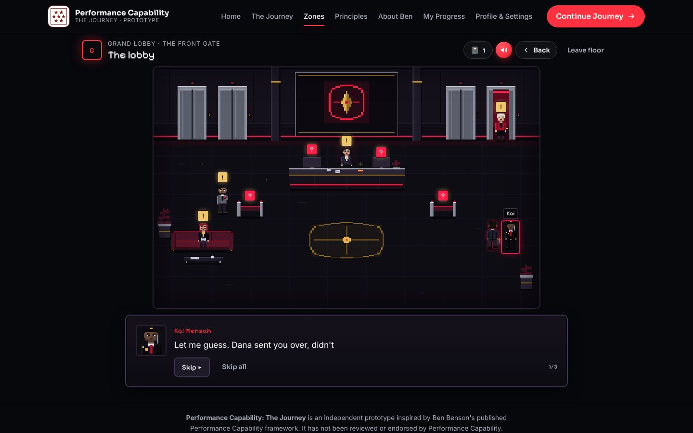

# Performance Capability: The Journey

**Four floors. Four problems nobody has solved. One new performance lead.**

A character-driven pixel-art RPG for the browser, inspired by Ben Benson's published **Performance Capability** framework. It's your first week as the new performance lead at Halcyon Tower. You walk each floor, talk to the people there, find what everyone else missed, make the call, and live with what happens next. The learning comes from the consequences, not from instructions.

> **Status: playable prototype (v0.2).** All four floors can be played from start to finish.
>
> This is an independent prototype, **not** reviewed or endorsed by Ben Benson or Performance Capability. Scenarios and characters are fictional.
>
> It has **not yet been tested with real players.** See [docs/PLAYTEST.md](docs/PLAYTEST.md) for the protocol.



## Run it

Requires Node 20+.

```sh
npm ci
npm run dev        # http://localhost:5173
npm test           # unit tests (Vitest)
npm run build      # typecheck + production build into dist/
npm run e2e        # after a build: end-to-end checks in Chromium (needs Playwright + Chromium)
```

A standalone nine-screen prototype of the Ground floor lives in [`prototype/`](prototype/README.md) (`npm run e2e:prototype` tests it).

`dist/` works from any static host or sub-path. `.github/workflows/deploy-pages.yml` publishes to GitHub Pages from `main`. The page asks search engines not to index it.

## How to play

- **Walk:** click or tap the floor, or use the arrow keys or WASD.
- **Talk and examine:** click a person or object; you walk over to it. Or stand next to it and press **E**. Markers show what's new: **!** for people, **?** for things, **☎** for phones. The buttons under the room do the same thing without walking.
- **Decide:** when someone asks you a question, pick a reply and press **Say it**. Some replies only appear once you've found the right person or clue.
- **Notebook:** 📓 in the top bar holds every clue you've found. At the end of each floor you write in your notebook.
- **Report:** each floor ends with a medal, what it took, how your choices played out, and how many outcomes you haven't seen yet. **Play it differently** to find them; your best medal is kept.
- **Secrets:** each floor hides a memo from the Tower's founder. They have no markers.

## Opening, sound and voice

- **Opening:** every visit starts, silently, with the Performance Capability logo fading in while a dark red neon ring blooms outward from behind it. After about five seconds it closes in reverse (the rings fold back into the centre and the logo fades) and hands over to Home. Click, tap or press any key to skip. Under reduced motion it's a short, still fade.
- **Motion:** pages ease in, embers drift in the background, panels rise as you scroll, and cards tilt in 3D under the cursor. All of it is off under reduced motion.
- **The Codex** (Principles): three 3D level slabs with flip cards for the twelve principles (each level's cards stay locked until you resolve its floor), a turning Seven Stars constellation, and collectable insight cards. Sources and verification notes sit in one collapsible section.
- **Sound effects:** buttons, replies, discoveries, secrets and medals each have their own sound. They're synthesized live with the Web Audio API, so there are no audio files.
- **Dialogue** is written the way people actually talk at work: polite where it should be, casual where it can be, in plain words. Characters hedge, interrupt themselves and joke a little, so it reads like a conversation rather than a textbook.
- **Voice-over:** dialogue, questions and reactions are spoken aloud.
  - **Natural voices from ElevenLabs.** Every line has its own recording, with one voice per character. The recordings are generated ahead of time and shipped as MP3 files in `public/voice/`. The API key never reaches the browser. See [Natural voices (ElevenLabs)](#natural-voices-elevenlabs).
  - **Until those files exist,** or for any line that has none, the game falls back to the device's best built-in voice, at a natural pitch and with a consistent voice per character. Where speech isn't supported, the game is text only.
- **Speak instead of typing.** Wherever you type (the name on your pass and your notebook notes), two round red buttons sit inside the field.
  - The **mic** (speech-to-text) floats gently. Tap it and talk; it pulses while it's on, and your words appear as you speak. Tap it again to stop. For a name, speaking replaces the field; for a note, it adds to what's there.
  - The **sound wave** forms only while your voice is actually being heard, and settles as soon as you pause. On desktop Chrome and Edge it follows your real voice level. Phones and Safari can't share the mic with a level meter, so there it's driven by the speech recogniser's own events.
  - The **speaker** reads the field back to you (text-to-speech).
  - Typing and editing always work too. Problems (a blocked mic, no speech heard) show as one short line under the field; otherwise there's no extra text.
  - Voice typing uses the browser's own speech recognition (Chrome, Edge, Safari). Some browsers transcribe on their maker's servers. Firefox has none, so the mic is greyed out there.
- **The in-game mute button** is the same round red button, and turns grey when muted.
- Turn either off in **Settings**, or use 🔊 in the in-game bar.

## The Tower

| Floor | Room | Zone (framework alignment) | Situation |
|---|---|---|---|
| Ground | Grand Lobby | 1 The Foundation · Level 1: Transactional | **The Front Gate.** A night guard with perfect training scores keeps getting the new gates wrong. |
| 7 | Data Vault | 2 The Shift · Level 2: Transformational | **The Red Line.** Response times rose when a new analyst arrived. Make a call, live with it for two weeks, find what changed, and choose again. |
| 23 | Break Lounge | 3 The Horizon · Level 3: Transcendental | **The Late Shift.** One team is "winning" while the cost lands elsewhere. See what your recommendation looks like three months later. |
| 40 | Executive Suite | 4 The Integration Trial · **game capstone, not a framework level** | **The Top Floor.** A live outage with three phases. Who answers the desk phone depends on what you did on the floors below. |

Each floor opens when the one below it is resolved. Earlier decisions carry forward. For example, if you paired Kai with Margit in the lobby, Kai is the one guiding the on-call engineer on Floor 40.

## Medals: transparent learning criteria

Each floor's door shows these before you play, and the report ticks them after:

| Medal | Criterion |
|---|---|
| 🥉 Bronze: resolved | See the situation through to the end and write in your notebook. |
| 🥈 Silver: sound judgement | No decision rated weak, and a reasoning score of 60% or more. |
| 🥇 Gold: mastery | Every decision rated strong, each made after examining every source available at the time. |

**The reasoning score** averages five criteria: evidence examined, diagnosis, developing capability, wider impact, and reflection (completion only). It's shown in full in the report's collapsed "How this floor was judged" section. It rates choices in fictional situations; it is **not** a measure of a person.

**Other rewards:** insight fragments (one per strong decision), the founder's four memos, artefacts, XP (best run kept), and twelve achievements for learning behaviours. There's no randomness and nothing to buy.

## Framework content

The framework is **never named during play.** A unit test fails if framework terms appear in in-play feedback. Deeper explanations live in three optional places: the report's **Field notes**, the journal, and the **Principles** page.

Every framework item carries a verification badge: Published, Published (summarised), Placeholder for Ben, or Written for the game. Principles 5–12, the Level 2 and 3 descriptions, the seven needs and a fuller biography are **placeholders for Ben to review**. See [docs/RESEARCH-AND-AUDIT.md](docs/RESEARCH-AND-AUDIT.md) and `src/content/principles.ts`.

## Assets

- **Pixel rooms:** the four supplied scenes, at `src/assets/rooms/*.svg`. They were extracted from the design exports, with no runtime and no scripts. The player sprite is derived from the lobby's walking figure, and every portrait is a live crop of the room art.
- **Not used:** the supplied `chapter2_season7_map.glb`. Its texture is Epic Games' Fortnite map, which the Sketchfab CC-BY licence can't cover, and it's a bright fantasy island. See the audit doc.
- **Logo:** the Performance Capability logo, used as supplied on a light plate.

## Natural voices (ElevenLabs)

The voices are made once, ahead of time, so the site itself stays static and your API key stays private.

1. **Add the key.** In the GitHub repo, open **Settings → Secrets and variables → Actions → New repository secret**. Name it `ELEVENLABS_API_KEY` and paste your ElevenLabs API key as the value.
2. **Run the generator.** In **Actions**, run **Generate voices (ElevenLabs)** on `main`.
   - It makes audio only for lines that don't have any yet, and commits it to `public/voice/`.
   - The Pages site then redeploys with the voices.
   - Run it again after editing dialogue: changed lines get new audio, and untouched lines are skipped.
   - Tick **prune** to delete audio for lines that no longer exist.
3. **Or run it locally** with `ELEVENLABS_API_KEY=... npm run voices`, then commit `public/voice/`. `npm run voices -- --dry` counts lines and characters without calling the API.

- **Cost.** There are 156 spoken lines, about 11,900 characters. That's a little over the ElevenLabs free tier's monthly allowance, so either use a paid plan or run it across two months: it resumes where it stopped.
- **Voices.** Each character's voice is set in `tools/voices.config.json`. They default to ElevenLabs' stock voices, and you can swap any of them for a voice from your own library. The script checks every voice ID against your account before it spends anything.
- **How a line finds its file.** Each file is named after the speaker plus a hash of the exact words (`src/app/voice-lines.ts`). The game and the generator share that code, so they always agree.

## Architecture

```
src/assets/rooms/  pixel-art room markup (480 × 300)
src/content/       scenarios (one per floor), characters, zones, principles   (plain data)
src/engine/        scenario engine, medals, progression, progress store, validation   (pure TS, no DOM)
src/ui/            RoomStage (movement + hotspots), sprites/portraits, play panels, screens
src/app/           React state, hash router, a11y helpers
```

- **Data-driven scenarios.** Each scenario is a list of stages: `narrative`, `explore`, `decision`, `aftermath`, `review` and `reflection`. Content can react to the player in several ways:
  - Lines, hotspots and reactions can depend on what the player has inspected, on earlier choices in the same run, or on flags from earlier floors.
  - Options can be `unlockedBy` discoveries.
  - Hotspots can be `secret`.
  - `validateScenario` runs in the tests. It checks references, room bounds, that required hotspots aren't conditional, that unlocks can be reached, that rubrics are consistent, and more.
- **Real movement.** `RoomStage` tracks the player's feet in room pixels, blocks furniture, and walks to whatever you click. If the path is blocked, you interact from where you stand. Under reduced motion, movement and typing are instant.
- **Persistence** uses localStorage `pc-journey.progress`, schema v2. Everything loaded is validated and clamped. This is a single-browser demonstration store, **not** secure multi-user persistence.

## Testing

- `npm test`: **46 unit tests**, covering:
  - content validation
  - discovery-gated options
  - inspected-dependent dialogue
  - secrets excluded from evidence
  - medals
  - delayed consequences
  - carry-over between floors
  - persistence against hostile, corrupted or old saves
  - unlocks and achievements
  - that every floor can be finished, and scores 100% on the best path, with or without earlier flags
  - voice lines: stable file keys, stage directions not spoken, and a voice configured for every speaker
- `npm run e2e`: **13 checks** in Chromium against the production build:
  - the opening (logo fade and ring bloom, auto hand-over, replays on every visit)
  - sounds generated and lines spoken (counted, not listened to)
  - home, navigation and active states
  - locked floors
  - the pass, including voice typing: the wave appears only once speech is heard, the name fills in, and reading it back works (a stand-in recogniser, since headless Chromium has no microphone)
  - the lobby: click and keyboard walking, talking, a refresh mid-floor, a locked reply that opens after finding Margit, a secret memo, gold
  - replay keeping the best medal and teasing undiscovered outcomes
  - Floors 2–4 with carry-over
  - progress (all memos and achievements)
  - settings and reset
  - **a skimmer who reads nothing and picks the first reply on every floor**, to prove there are no dead ends
  - a 375px phone pass with no horizontal overflow
  - zero console errors

  Screenshots are in [`docs/screenshots`](docs/screenshots).

## Known limitations

- **No human playtests yet.** The acceptance step "test with people unfamiliar with the framework" is still to do. Use [docs/PLAYTEST.md](docs/PLAYTEST.md).
- **Framework placeholders** remain until Ben supplies the content.
- **Option ratings** are the author's judgement, not validated.
- **Movement is direct.** Walking is a straight line with sliding along furniture, not full pathfinding. Characters in the art are fixed in place and don't walk around.
- **Off-floor characters** (Kai, Rafael and Priya on Floor 40) appear only by phone, because they aren't drawn in that room.
- **Progress is local** to one browser.

## Next steps

1. Run the playtest protocol with 5–8 people, then fix what it finds.
2. Ben reviews the placeholders. Re-link the gameplay concepts to official principles.
3. Animate the cast: idle frames and a few walking NPCs.
4. Add a second branch per floor, and characters who remember you across floors.
5. A facilitator mode, and an export of the journal for coaching sessions.
