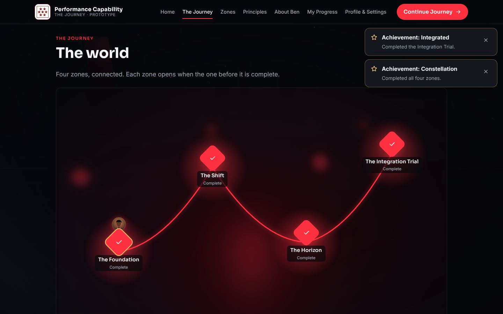

# Performance Capability: The Journey

**Discover how you perform. Develop how you think. Change what you achieve.**

A character-based learning game prototype for the browser, inspired by Ben Benson's published **Performance Capability** framework. The player:

- creates a character
- explores a connected world of four zones
- talks to people and examines evidence
- makes decisions and lives with their consequences
- gets a transparent debrief and replays to try a better approach

> **Status: playable prototype (v0.1).** All four zones can be played from start to finish.
> - Zone 1 is the polished vertical slice.
> - Zones 2–4 use the same engine, with first-draft content.
>
> This is an independent prototype. It has **not** been reviewed or endorsed by Ben Benson or Performance Capability. Scenarios and characters are fictional.



## Run it

Requires Node 20+.

```sh
npm ci
npm run dev        # http://localhost:5173
npm test           # unit tests (Vitest)
npm run build      # typecheck + production build into dist/
npm run e2e        # after a build: end-to-end checks in Chromium (needs Playwright + Chromium)
```

The build uses a relative base, so `dist/` works from any static host or sub-path. `.github/workflows/deploy-pages.yml` publishes it to GitHub Pages on pushes to `main`, once Pages is set to "GitHub Actions" in the repository settings.

## What's implemented

| Screen | Route | What it does |
|---|---|---|
| Home | `#/` | Cinematic introduction over a Three.js obsidian world, with Begin or Continue |
| Character creation | `#/create` | Name plus one of four looks (cosmetic only). Validated. |
| World map ("The Journey") | `#/journey` | Four zones joined by pathways, showing locked, open, in-progress or complete. Your character marks where you are. |
| Zones | `#/zones` | All zones with their environment art and state |
| Zone overview | `#/zone/:id` | Objectives, cast, best score, Start, Resume or Replay, framework links and the zone artefact |
| Scenario | `#/play/:id` | Narrative, exploration with hotspots, dialogue, decisions, consequences, aftermath, review and reflection, with Back and Exit at every stage |
| Debrief | `#/debrief/:id` | Rubric scoring, what held up, opportunities, paths not taken, misleading clues, framework links, rewards and replay |
| Principles | `#/principles` | Levels, all twelve principles, the Seven Stars, gameplay concepts and how each scenario maps to them. Each item shows a verification badge. |
| About Ben | `#/about` | A factual introduction from published material, a labelled biography placeholder, official links and a disclaimer |
| My Progress | `#/progress` | XP, emblems and artefacts, achievements, the progress map, decision history, learning journal and evidence archive |
| Profile & Settings | `#/settings` | Edit character, motion, text size, 3D on/off, a data notice, and reset with confirmation |

Navigation is persistent. On desktop it shows the logo, seven links and a crimson **Continue Journey** button. On mobile it shows the brand mark, Continue, and a hamburger drawer (closes with Escape). The active link is highlighted, and every link goes to a working screen.

### The four zones

| Zone | Framework alignment | Scenario | What's distinctive |
|---|---|---|---|
| 1 The Foundation | Level 1: Transactional | **The Stalled Rig.** A technician who passed his training keeps failing on new equipment. | 7 evidence sources (one misleading), a diagnosis decision, then a response decision. Teaches knowing vs. doing and symptom vs. cause. |
| 2 The Shift | Level 2: Transformational | **The Signal Room.** Response times rose when a new analyst joined. | You decide on incomplete information, see the consequence two weeks later, uncover new evidence, then **rewind** and choose again. |
| 3 The Horizon | Level 3: Transcendental | **The Meridian Launch.** One team is "winning" while others absorb the cost. | Opens by reviewing your earlier decisions. Your strategy's **three-months-later** consequences play out across the system. A locally successful choice backfires. |
| 4 The Integration Trial | Game capstone (**not** a fourth framework level) | **The Crucible.** A live outage with three layers: a capability gap, a wrong assumption and a commitment trade-off. | Earlier decisions change the cast and the evidence. For example, if you paired Kai with Theo in Zone 1, Kai now guides the on-call engineer. Ends with a journey-wide debrief. |

Zones unlock in order. Zone 1 opens when you create a character. Each later zone opens when the zone before it is complete, which requires finishing its reflection.

### Scoring: transparent, and about decisions rather than people

Each scenario is scored on up to five criteria, each from 0–100%. The overall score is their average.

| Criterion | How it's scored |
|---|---|
| Evidence gathering | Share of the available sources you examined before each decision |
| Diagnosis, Developing capability, Wider impact | 0–2 points per decision, set by the scenario author on each option |
| Reflection | Completion only. What you write is never scored. |

The debrief shows the table, the per-decision points, and a "What the game can't tell" section. It says plainly that the score is not a validated measure of a person.

XP works as follows:
- 30 for completing a scenario
- 5 per evidence record (up to 50)
- 15 for reflecting
- up to 50 scaled by the score

Replays keep your **best** XP, so repetition doesn't inflate it.

The other rewards are:
- **Insight fragments:** one per strong decision
- **Evidence records:** collected in an archive
- **Capability emblems and zone artefacts:** one of each per completed zone
- **Ten achievements:** all for learning behaviours, such as "Evidence First", "Assumption Breaker" and "Journal Keeper"

There is no randomness, paid content or loss-chasing.

## Framework content and verification

The official sites couldn't be fetched from the build environment, so framework content was taken from search extracts of the official pages. See [docs/RESEARCH-AND-AUDIT.md](docs/RESEARCH-AND-AUDIT.md). Every item in `src/content/principles.ts` carries a status, shown as a badge in the UI:

- **Published:** a title as published, for example Principle 1, "You Can't Develop What You Don't Accept", and Level 1, "Mastering the Content".
- **Published (summarised):** summarised from published material. Ben should confirm the wording.
- **Placeholder for Ben:** principles 5–12, the Level 2 and 3 descriptions, the names of the seven needs, and a fuller biography. Nothing was invented to fill these.
- **Written for the game:** six short gameplay concepts used in feedback, kept separate on the Principles page.

**For Ben to review:**
1. The Level 2 and 3 descriptions, and whether "Mastering the Context" and "Mastering the Contribution" map to them.
2. Principles 2–12 (titles and descriptions).
3. The seven needs.
4. The About page wording.

All of these live in `src/content/principles.ts` and `src/ui/screens/AboutScreen.tsx`.

The logo is used as supplied, unaltered, on a light plate so it stays legible on the dark theme. It is not used to imply endorsement.

## Architecture

```
src/content/  scenarios, characters, zones, principles   (plain data)
src/engine/   scenario-engine, progression, progress-store, validation   (pure TS, no DOM)
src/app/      React state (game.tsx), hash router, a11y helpers
src/ui/       screens, the scenario runner (ui/play), SVG portraits and scene art
src/world/    Three.js ambient world, lazy-loaded behind a WebGL check
```

- **Data-driven scenarios.** A scenario is an ordered list of stages: `narrative`, `explore`, `decision`, `aftermath`, `review` and `reflection`.
  - Hotspots, lines and reactions can carry conditions on earlier decisions in the same run, or on **flags** from earlier scenarios.
  - Hotspots can be revealed only after a decision.
  - To add a scenario, write one object in `src/content/scenarios/`, list it in `index.ts` and add its id to a zone.
  - `validateScenario` runs in the tests and catches unknown characters or principles, unreachable or conditional required hotspots, rubric mismatches, missing feedback and similar errors.
- **Predictable state.** Every engine function takes a run and returns a new one. Runs are saved on every change, so a refresh resumes exactly where you were. Saved runs are re-checked against current content when loaded.
- **Persistence** uses localStorage under `pc-journey.progress`, schema v1. All loaded data is validated and clamped, and corrupted or foreign data falls back to a fresh start. **This is a single-browser demonstration store, not secure multi-user persistence.**
- **3D** is used only for the ambient world behind Home, Character creation and the map:
  - monoliths, fog, embers and four zone beacons that light up as zones open
  - loaded lazily and paused when the tab is hidden
  - static under reduced motion
  - falls back to a CSS backdrop when WebGL is missing, switched off or lost
  - gameplay scenes are lightweight layered SVG, which is clearer and cheaper than 3D on phones

### Accessibility

- Skip link, and focus moves to each new screen's heading
- Live-region announcements
- Every hotspot is a real button and is also listed as text
- Keyboard and touch support throughout, with 44px targets
- Reduced-motion and large-text settings
- Forced-colours support
- Text and portraits are never the only way information is conveyed

## Testing

- `npm test`: **39 unit tests**, covering:
  - content validation for every scenario and zone
  - engine transitions, evidence tracking, meters (including delayed effects), scoring, conditional content and run restoration
  - progress store round-trips and hostile, corrupted or blocked storage
  - unlock order, Continue Journey, flags carrying between zones, and achievements
- `npm run e2e`: **12 checks** against the production build in Chromium, served under a sub-path:
  - every nav link and its active state
  - locked zones before a character exists
  - character validation
  - the full Zone 1 playthrough, including a refresh mid-scenario, Back, a perfect score and paths not taken
  - persistence after reload, and a weak replay keeping the best score
  - Zones 2–4 played in order, with carry-over between zones
  - the progress, principles and about pages
  - settings, 3D off, reset cancel and confirm
  - a 375px phone pass: no horizontal overflow on any screen, the drawer, and a full scenario
  - a no-WebGL fallback
  - zero console errors

  Screenshots are in [`docs/screenshots`](docs/screenshots).

## Known limitations

- **Framework content is incomplete by design.** Principles 5–12, the seven needs and the biography are placeholders until Ben supplies them.
- **Content depth varies.** Zones 2–4 are complete and playable but shorter, first-draft scenarios. Option ratings are the author's judgement and haven't been reviewed by Ben or tested with learners.
- **Scoring isn't validated.** It rates choices in fictional scenarios and must not be used to assess people.
- **Free-text reflections aren't analysed.** They are only stored in the journal.
- **Progress is local only.** It stays on one device and browser, with no accounts or sync. Clearing browser data erases it.
- **Fonts may fall back.** Fonts load from Google Fonts. Where that's blocked, system fonts are used.
- **Movement is limited.** It's point-and-move within each scene (your token walks to whoever you talk to), not free 3D roaming.

## Recommended next steps

1. Ben reviews and supplies the placeholder framework content, then the gameplay concepts are re-linked to official principles where they fit.
2. Playtest with target learners. Calibrate the option ratings and check that the feedback reads as developmental, not judgemental.
3. Deepen Zones 2–4 to the level of Zone 1: more evidence, a second branch, and characters who remember you.
4. Add a facilitator mode and an export of the learning journal, so the game can support coaching sessions.
5. If multi-user use is needed, add authenticated server persistence and privacy review before collecting any reflections.
6. Optional: a 3D exploration mode for desktop, keeping the SVG scenes as the accessible default.
